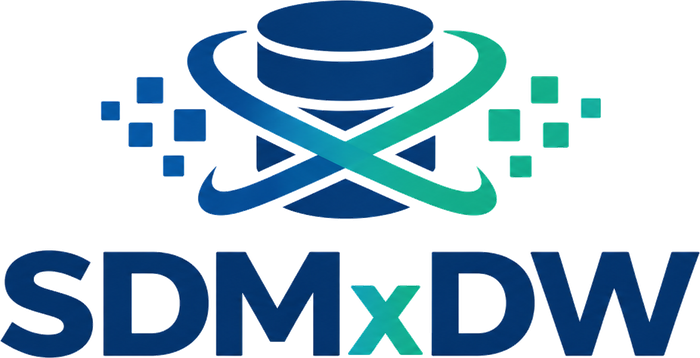
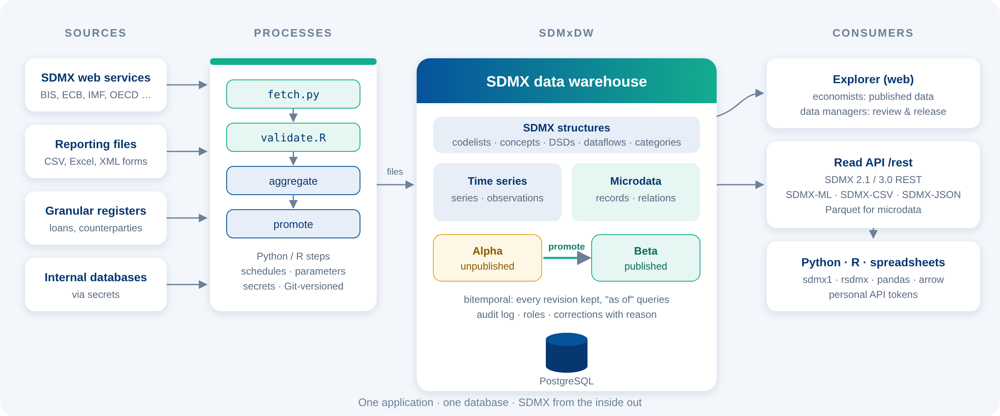
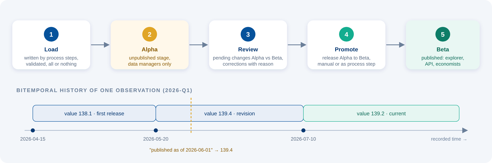
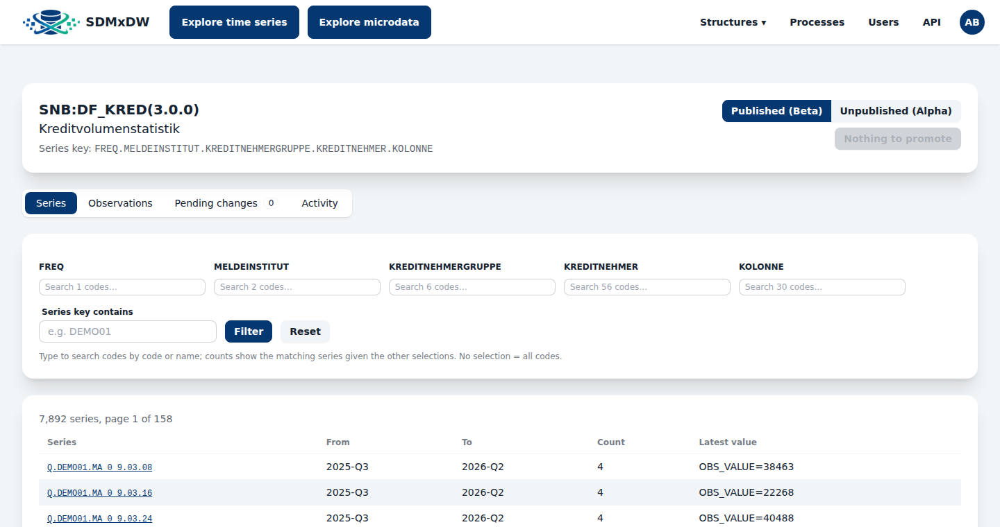
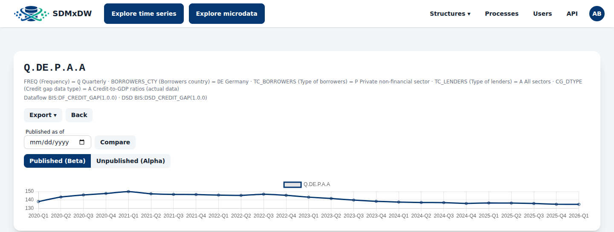
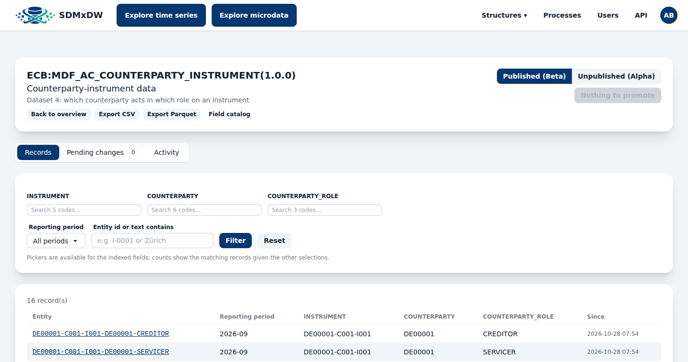
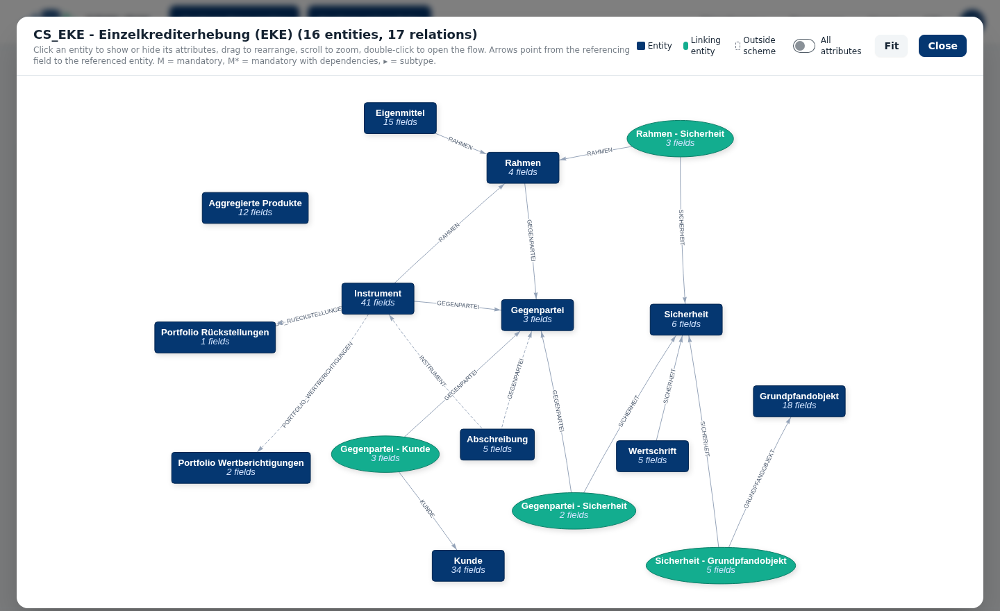
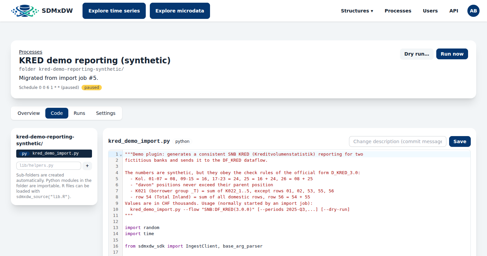
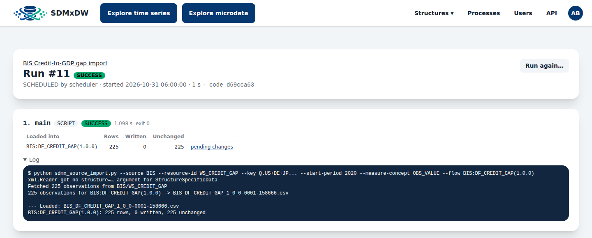

<p align="center"></p>

# SDMxDW – the Statistical Data and Metadata Warehouse

**SDMxDW** is a data warehouse for central banks and statistical offices that is built around the **SDMX standard** from the ground up. It keeps **time series** and **granular microdata** in one application. It records every revision of every value, separates unpublished from published data with a release workflow, and hands data out through a standard **SDMX REST API**. Python, R and other SDMX tools can read it directly.

> **In one sentence:** load data with Python or R processes, check it as a data manager, release it with one click, and economists get it in the explorer or in their own scripts via SDMX.

---

## Why SDMxDW?

Statistical organisations usually run several systems side by side. A time series database feeds publications, credit registers and other granular data live elsewhere, import jobs are scattered across servers, and every user has their own Excel extract. SDMxDW brings these together:

- 🧩 **SDMX inside, not just at the border.** Codelists, concepts, data structure definitions (DSDs) and dataflows are the actual data model, not an export format. Whatever you store can be queried with standard SDMX tools straight away.
- 🕰️ **Nothing is ever overwritten.** All data is *bitemporal*: every revision is kept, and you can ask "what did we publish on 1 June?" at any time.
- ✅ **Controlled publication.** New data first lands in an unpublished stage. Data managers review the differences and then release them.
- 🧮 **Time series and microdata together.** Aggregated statistics and the granular records they are computed from live in the same system and use the same codelists.
- 🐍 **Code where statisticians work.** Imports and calculations are ordinary Python or R scripts, versioned in Git and scheduled by the application.

---

## How it fits together



1. **Sources:** SDMX web services (BIS, ECB, …), reporting files, granular registers or internal databases.
2. **Processes:** Python or R scripts fetch and transform the data. They write it as **SDMX-CSV or Parquet files**, and SDMxDW loads these files. A step is loaded completely or not at all.
3. **The warehouse:** SDMX structures, time series and microdata are stored in PostgreSQL, with the Alpha/Beta stages, full history and an audit log.
4. **Consumers:**
   - **Explorer** in the browser
   - **Read API** (`/rest`) for Python (`sdmx1`, pandas), R (`rsdmx`, arrow) and anything else that speaks SDMX

---

## The data lifecycle



| Stage | Who sees it | What happens |
|---|---|---|
| **Alpha** (unpublished) | data managers | Processes and corrections write here. Changes against Beta are shown as *pending changes*. |
| **Beta** (published) | everyone | Released by *promotion*, manually in the explorer or automatically as a process step. |

Every write creates a new version instead of overwriting the old value:
- **"Published as of"** shows the data exactly as it was published on a given day. Reports and models can be reproduced later.
- **"Compare"** shows what changed between two dates.
- Each value has a **revision history**, and corrections in the explorer require a reason.
- An **activity log** records who changed what and when.

---

## What SDMxDW can do

### 📐 SDMX structures
- Concept schemes, codelists, data structure definitions (DSDs), dataflows
- Category schemes with **Markdown descriptions**, plus categorisations to organise dataflows by topic
- Everything is maintained in the web interface and published through the SDMX structure API

### 📈 Time series explorer



- **Searchable dimension pickers** offer the codes from each codelist. Live counts show how many series match given the other selections.
- Free-text search on series keys, and paging for flows with many thousands of series
- **Series view** with chart, observation table, revisions, "published as of" and export (SDMX-CSV, SDMX-ML, JSON)



### 🧾 Microdata (granular data)
- A generic container for register-style data: one record per entity and reporting period, described by a **field catalog** with codelists, mandatory rules, references between flows and repeating groups
- Ready for granular register data such as **ECB AnaCredit** or the **SNB EKE** (Einzelkrediterhebung): you define the structures for your own collection, and SDMxDW stores, versions and publishes the data
- Same explorer pattern as for time series: pickers for indexed fields, record pages, pending changes, corrections with reason and an activity log
- Export as **SDMX-CSV, JSON or Parquet**



The **relations view** draws the whole data model of a scheme as an entity-relationship graph. Example: an EKE-style scheme with 16 entities and how they reference each other.



### ⚙️ Processes
Imports, aggregations and analyses are **processes**. Only data managers can manage them.
- **Metadata in the database:** name, steps, schedule, parameters, secrets, chaining, timeout, notification
- **Code in a process folder:** one sub-folder per process with any number of Python (`.py`) or R (`.R`) files, plus shared SDKs. The folder can be linked to a **Git repository**: saving in the app commits and pushes, and changes made in an IDE can be pulled.
- **Steps:**
  - `SCRIPT`: Python or R
  - `AGGREGATE`
  - `PROMOTE`
  - `PROCESS`: starts a sub-process

  Steps can depend on each other (`needs`), so whole cascades are possible.
- **No token juggling:** runs started by SDMxDW are trusted. Scripts get a short-lived read credential and hand back files, which SDMxDW loads into Alpha in a single transaction.
- **Built-in editor** with syntax highlighting, dry runs (validate everything, write nothing), live log, cancel, schedules (cron), run history with the Git commit of the code, and e-mail on failure.





### 🔌 Read API for Python, R and other tools
- **SDMX 2.1 and 3.0 REST** for structures and data: SDMX-ML (Generic and StructureSpecific), SDMX-CSV, SDMX-JSON
- Key filters (`Q.DE+US..A`), `startPeriod`/`endPeriod`, `asOf` for published-as-of queries
- Microdata as SDMX-CSV, JSON or Parquet, with filters
- **Personal API tokens** created in the user profile
- Tested with Python **`sdmx1`** and R **`rsdmx`**. Interactive documentation (OpenAPI) is in the app under **API**.

```python
import os, sdmx

sdmx.add_source({"id": "SDMXDW", "name": "SDMxDW", "url": "https://<host>/rest"}, override=True)
client = sdmx.Client("SDMXDW")
client.session.headers["Authorization"] = f"Bearer {os.environ['SDMXDW_TOKEN']}"

dsd = client.dataflow("DF_KRED", agency_id="SNB").dataflow["DF_KRED"].structure
df = sdmx.to_pandas(client.data("DF_KRED", key="Q.DEMO01._T.39.26", dsd=dsd))
```

### 👥 Roles
| Role | Can do |
|---|---|
| **Economist** | explore and download published (Beta) data, use the read API |
| **Data manager** | everything above, plus unpublished data, corrections, promotion, structures, processes, users |

---

## Technology

| Area | Choice |
|---|---|
| Backend | Java 25, Spring Boot, Spring Data JDBC, Spring Security |
| Database | PostgreSQL (partitioned observation tables), Flyway migrations |
| Frontend | Server-side Thymeleaf, htmx, Tailwind CSS and daisyUI, Chart.js, CodeMirror |
| Data files | DuckDB (Parquet), JGit (process folder) |
| Processes | Python 3, R (optional) |
| Operations | a single JAR as a systemd service, Actuator health checks |

---

## Running

Requirements: JDK 25, PostgreSQL 16+, Python 3 (for processes; `sdmx1` for SDMX source imports),
optionally R.

```sh
createdb sdmxdw            # plus a user with access, see ops/sdmxdw.env.example
export SDMXDW_DB_PASSWORD=... SDMXDW_ADMIN_PASSWORD=...
./mvnw package -DskipTests
java -jar target/sdmxdw-0.0.1-SNAPSHOT.jar
```

Open http://localhost:8080 and log in as `admin@sdmxdw.local` with `SDMXDW_ADMIN_PASSWORD`. If it
is not set, a random password is generated and printed to the log once. You must change it at the
first login. All settings are environment variables, see `ops/sdmxdw.env.example`;
`ops/sdmxdw.service` is a systemd unit, `ops/backup-postgres.sh` a backup job.

**Back up** the secret key file (`SDMXDW_SECRET_KEY_FILE`) once, and keep it separate from the
database dumps: process secrets and the Git token are encrypted with it. Without it they cannot be
decrypted; with it and a dump, anyone can.

## Development

```sh
./mvnw spotless:apply      # formatting (google-java-format)
./mvnw verify              # tests; need a PostgreSQL database sdmxdw_test (SDMXDW_TEST_DB_*)
```

* `ops/seed/` contains the scripts that build the demo structures (EKE v5, AnaCredit, KRED).
* `ops/codemirror/` contains the recipe for the bundled editor.
* Documentation of the read API is in the app under **API**; how to write process steps is in
  `shared/README.md` of the process folder.

## Licence

SDMxDW is licensed under **MIT No Attribution (MIT-0)**, see [LICENSE](LICENSE): use, change and
redistribute it for any purpose, without any conditions and without having to credit us.

Third-party components keep their own licences: the libraries pulled in by Maven (mostly Apache 2.0,
see `pom.xml`) and the bundled CodeMirror editor (MIT, see
`src/main/resources/static/js/vendor/codemirror.js.LICENSE.txt`). If you redistribute the built
JAR, include their licence notices. The name and logo "SDMxDW" are not covered by the licence.
